# POC: comprobantes compartidos hacia CobroRutApp

Fecha: 2026-10-13. Estado: propuesta para revisión; sin implementación.

## Objetivo

Permitir que el cobrador reciba una captura por cualquier aplicación, pulse `Compartir`, elija CobroRutApp y obtenga una extracción provisional para revisión. El mecanismo usa Android Sharesheet; no lee conversaciones, no controla WhatsApp, no usa WhatsApp Business API y no envía mensajes.

La captura constituye evidencia. Nunca confirma por sí sola que el dinero ingresó ni modifica saldo.

## Flujo

```mermaid
flowchart LR
    A[Cliente envía captura] --> B[Cobrador pulsa Compartir]
    B --> C[CobroRutApp recibe image/*]
    C --> D[Validar y copiar a almacenamiento privado]
    D --> E[Hash y detección de duplicado técnico]
    E --> F[OCR local]
    F --> G[Parser Yape / Plin]
    G --> H{Confianza suficiente}
    H -->|Sí| I[Vista previa]
    H -->|No| J[Pendiente manual o Gemini opcional]
    J --> I
    I --> K[Sugerir clientes]
    K --> L[Cobrador selecciona cliente y préstamo]
    L --> M[EN_REVISION]
    M --> N[Validación contra ingreso bancario]
    N --> O[Confirmar y aplicar idempotentemente]
```



## ¿Se necesita IA?

No para el primer intento. Las capturas de comprobantes suelen tener texto y layouts repetitivos. La estrategia recomendada es escalonada:

1. OCR local en el dispositivo.
2. Parser determinista por formato observado de Yape y Plin.
3. Entrada/corrección manual si faltan campos.
4. Gemini Vision pagado solo como fallback, después de medir la POC local.

Ventajas del OCR local: funciona sin red, no envía el comprobante a terceros, evita costos y reduce latencia. ML Kit Text Recognition v2 es candidato para la prueba técnica; permite modelo Latin bundled disponible inmediatamente u otra variante descargada. No se adopta definitivamente hasta probar capturas reales anonimizadas en Z2474.

Gemini aporta valor en capturas recortadas, cambios de layout o jerarquía visual ambigua. Si se usa:

- la clave nunca vive en el APK;
- Android sube la imagen a un backend autenticado;
- se usa servicio pagado para datos reales;
- se minimiza y retiene la imagen por un plazo definido;
- la respuesta cumple un schema y sigue siendo provisional;
- el fallo de red deja el elemento pendiente para revisión manual.

## Integración Android

Android permite declarar `ACTION_SEND` con MIME `image/*`. La app aparece en el Sharesheet y recibe un `content://` URI en `Intent.EXTRA_STREAM` con permiso temporal de lectura.

Controles necesarios:

- aceptar solo una imagen por operación en la POC;
- comprobar MIME real, tamaño, dimensiones y decodificación;
- procesar I/O fuera del hilo principal;
- copiar inmediatamente a almacenamiento privado, porque el permiso del URI puede ser temporal;
- no solicitar permiso general de fotos o almacenamiento;
- eliminar metadatos innecesarios y generar hash SHA-256;
- no confiar en nombre de archivo, paquete de origen ni texto adicional del intent;
- impedir que el mismo intent se procese dos veces tras recomposición o recreación.

La Activity/app shell recibe el intent y entrega el URI a un contrato de dominio. La UI no abre archivos ni ejecuta OCR.

Distribución propuesta:

| Módulo | Responsabilidad |
| --- | --- |
| `:app` | Entrada `ACTION_SEND`, navegación y DI |
| `:core:domain` | Modelos/contratos de extracción y evidencia |
| `:integration:voucher` | Lectura segura del URI, imagen, OCR y parsers |
| `:core:data` | Room: evidencia, extracción, relación y estados |
| `:feature:income` | Vista previa, corrección, asociación y revisión |

## Datos extraíbles

```kotlin
data class VoucherExtraction(
    val provider: VoucherProvider,
    val amount: Money?,
    val senderDisplayName: String?,
    val recipientDisplayName: String?,
    val operationCode: String?,
    val occurredAtRaw: String?,
    val fieldConfidences: Map<VoucherField, Float>,
    val warnings: Set<VoucherWarning>,
)
```

- `amount` usa `Long` en céntimos y moneda `PEN`.
- `operationCode` se conserva como texto para no perder ceros.
- La fecha/hora original se conserva aunque no pueda interpretarse.
- No se debe inventar un dato ilegible.
- Proveedor desconocido queda `UNKNOWN`.

La POC debe descubrir con capturas permitidas qué campos aparecen realmente en Yape y Plin. No se presume que ambos incluyan número de operación, remitente y destinatario.

## Asociación con clientes

El nombre visible es del remitente del pago y puede pertenecer a un tercero. La extracción no devuelve `customerId` ni `loanId`.

1. Normalizar el nombre solo para búsqueda.
2. Buscar nombre/alias exactos confirmados en el directorio activo.
3. Mostrar cero, uno o varios candidatos.
4. Exigir selección explícita incluso con un candidato.
5. Exigir selección del préstamo/deuda.
6. Mostrar monto extraído para revisión, sin usarlo como identidad.

La imagen puede coincidir con una notificación Plin ya detectada o con un registro manual. Se conservan ambas evidencias y se propone vincularlas. No se crea otro abono automáticamente.

## Estados

```text
RECEIVED
  -> OCR_PROCESSING
  -> EXTRACTED | NEEDS_MANUAL_INPUT | EXTRACTION_FAILED
  -> CUSTOMER_SELECTED
  -> EN_REVISION
  -> CONFIRMED | REJECTED
  -> LINKED_TO_PAYMENT
```

`CONFIRMED` significa que un humano validó la evidencia contra una fuente de ingreso permitida; no que el OCR alcanzó alta confianza.

## Pantalla de revisión

La pantalla debe mostrar:

- miniatura de la imagen;
- proveedor sugerido;
- nombre de remitente;
- monto;
- operación y fecha/hora si existen;
- confianza/advertencias por campo;
- candidatos de cliente;
- préstamo elegido;
- indicios de otra evidencia posiblemente relacionada;
- acciones `Corregir`, `Dejar pendiente` y `Enviar a revisión`.

Nunca mostrar `Pago confirmado` inmediatamente después del OCR.

## Privacidad y seguridad

- Capturas reales fuera de Git y de logs.
- Sin nombres, teléfonos, montos o códigos en Crashlytics.
- Archivo privado sin backup hasta definir recuperación/retención.
- Límite de tamaño y píxeles antes de decodificar para evitar agotamiento de memoria.
- Procesamiento con copia inmutable y hash; correcciones no alteran la evidencia.
- Retención por definir en `BUSINESS_RULES_CHECKLIST`.
- Si se habilita nube, cifrado, acceso por ruta/organización y URL firmada corta.

## Plan de validación

1. Conseguir capturas Yape y Plin anonimizadas, propias y autorizadas, sin versionarlas.
2. Probar tema claro/oscuro, distintos tamaños, recortes y compresión de WhatsApp.
3. Medir por campo: exactitud de proveedor, monto, nombre, código y fecha.
4. Comparar OCR local + parser contra Gemini solo en fallos.
5. Comprobar compartir con app cerrada, abierta y en segundo plano.
6. Comprobar URI temporal, archivo demasiado grande, MIME falso, imagen corrupta y reenvío duplicado.
7. Validar vínculo con notificación Plin sin aplicar dos pagos.

Criterio para adoptar Gemini: mejora material y medida sobre los campos necesarios, con costo/privacidad aceptados. Si OCR local cubre los formatos de campo, Gemini no entra en la primera versión.

## Fuentes técnicas

- Android Sharesheet / recepción de datos: https://developer.android.com/develop/ui/compose/sharing/receive
- ML Kit Text Recognition v2: https://developers.google.com/ml-kit/vision/text-recognition/v2/android
- Gemini image understanding: https://ai.google.dev/gemini-api/docs/image-understanding
- Términos de Gemini: https://ai.google.dev/gemini-api/terms
